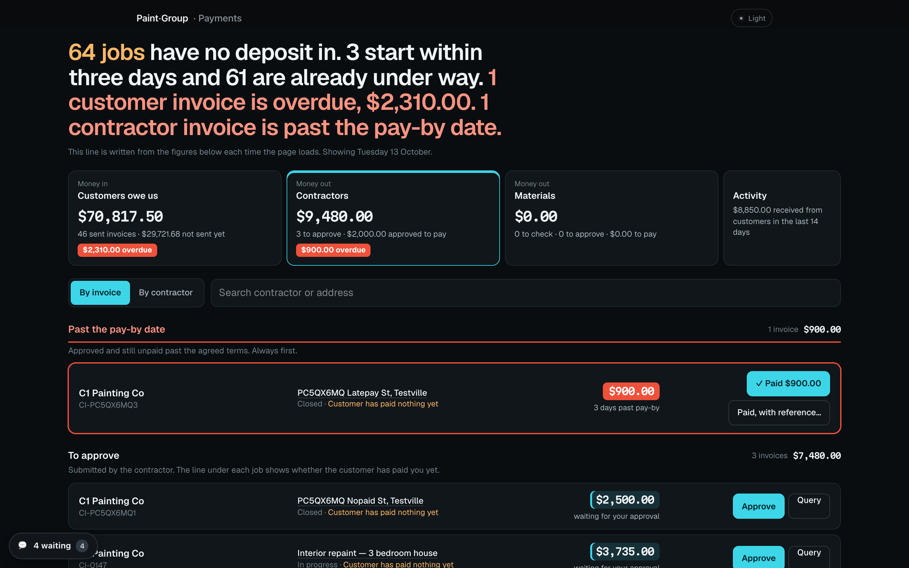
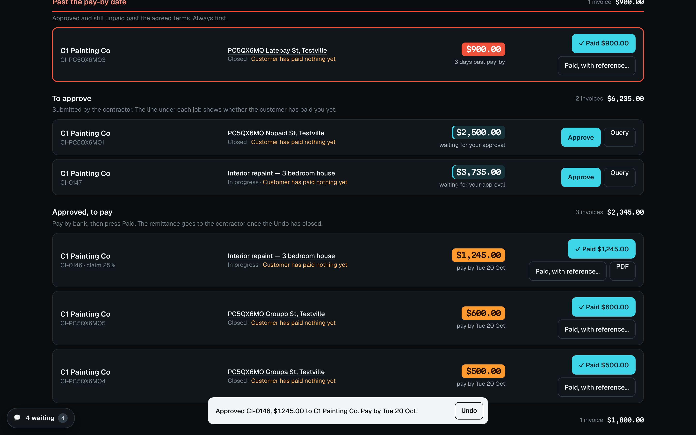
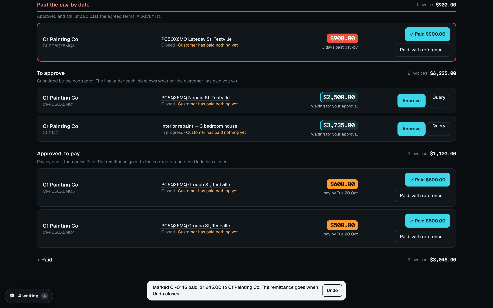

## What this is for
Contractors do not type invoices. The platform drafts each one from the job: the offer amount on the work order, plus approved variations, minus credits and any deduction the office set, minus what the contractor has already claimed. The contractor checks and submits; the office approves and records the payment. Nothing here moves money. The bank transfer happens in your banking, and **Paid** records it and sends the contractor a remittance advice.

## Before you start
- Open **Payments** from the sidebar and press the **Contractors** card. The address is /invoicing?tab=con. (Old links to the Payables tab land here.)
- Any manual deduction on a variation (a credit for scope removed after work started) must be set on the job before the contractor can submit. Until it is, their submit is held with "the office is finalising a pay adjustment".
- Have your bank reference ready if you want it on the remittance: **Paid, with reference…** asks for it and the payment date.

## Steps
1. Open **Payments → Contractors**. The card shows how many invoices wait for approval and what is approved to pay. The rows are in sections, worst first: **Past the pay-by date**, **To approve**, **Approved, to pay**, **With the contractor**, **Paid**. Each row has the company and invoice number, the job's address and stage, and what the customer has paid on that job. A progress claim says **claim 25%** under the invoice number.
   
2. Check the invoice against the job: the offer amount on the work order, the approved variations, and any deductions (press **Query** to message the painter on the work order). If something is wrong, the fix is made on the job (the variation or its deduction), and they re-submit.
3. Press **Approve**. The row moves to **Approved, to pay** and a bar at the bottom offers **Undo** for a few seconds. The contractor sees **Approved — payment coming**.
   
4. Make the bank transfer in your banking. Then press **✓ Paid** to record it as paid today, or **Paid, with reference…** to enter the bank reference and the date it went. The row moves to **Paid** and a remittance number is issued. The remittance advice goes to the contractor once the Undo has closed; their invoice page shows the payment date, reference and a **Download remittance advice** button.
   
5. Press the address on a row to open the job panel: the contractor's invoices sit under **Money out and profit** with the customer invoices, the costs and the job's gross profit.

## How the figures reconcile
- **Contract work** is the contractor payment recorded on the work order when the offer was sent.
- **Approved variations** are variations the customer approved and the contractor accepted, at the contractor's rate.
- **Less —** lines are credits for scope removed. Where work had already started, the office sets the figure on the variation and it appears to the contractor as "set by the office" with your note.
- **Less previously invoiced** takes off progress claims already submitted on the same job, so a job is never invoiced twice.
- **GST** is added **on top** of the agreed amount when the contractor was registered at the time they submitted (the offer, say 38.5 hours at $65 = $2,502.50, is the ex-GST subtotal and the invoice totals $2,752.75); the document then reads **TAX INVOICE**. Unregistered contractors submit an **INVOICE** for the agreed amount with no GST. What is "left to invoice" on a job is always counted in ex-GST figures, so a registered painter's GST never eats into their agreed amount.
- Approved contractor expenses ride on their next invoice as separate at-cost reimbursement lines.
- **RCTI**: a contractor who has signed the recipient-created tax invoice agreement shows an **RCTI** chip. Their drafts wait under **To approve** and are approved by the office without the contractor submitting; the figures are set at that moment.

## What the colours and labels mean
- **To approve** (blue) — submitted, or an RCTI drafted for them: waiting on the office.
- **Approved, to pay** (orange) — approved and owed; it shows the pay-by date.
- **Past the pay-by date** (red) — approved, unpaid and past the agreed terms. Always first.
- **Paid** (green) — payment recorded; the remittance goes once the Undo has closed.
- **Green · 3 business days** — a Green painter's fast terms. **Held — reason** — the office put them back on the normal terms; **Release** undoes the hold.
- **claim NN%** — a progress claim, not a sign-off invoice.
- The stage on the row (**In progress** and the others) — where the job is, so you can judge whether a claim is reasonable.

## If something goes wrong
- **The contractor says they cannot submit.** Either their company profile is incomplete (they fix it under Profile in the portal) or a variation credit is waiting on your deduction figure. Set it on the job and their button appears.
- **The amount does not match what you expected.** Compare against the work order offer and the variations on the job. Do not edit the invoice; correct the job and ask them to re-submit.
- **You approved the wrong invoice.** Press **Undo** on the bar straight away. If it has gone, do not mark it paid; contact whoever administers the platform to reverse the approval.
- **The remittance PDF is missing.** It renders shortly after the Undo closes; refresh. If it still has not attached after a few minutes, check the error monitor.

## Related
- [Offer a job to a painter and manage the booking](../scheduling/staff.md)
