## What this is for
The PC console (**Projects** in the sidebar) reads every open work order and tells you what needs a person. Jobs move through seven lanes: **01 Offer → 02 Booking confirmed → 03 Pre-start → 04 In progress → 05 Quality check → 06 Walkthrough → 07 Closed — signed off**. Nothing moves by typing a status: each move has a gate, and the console shows you the gate that is holding a job. The one exception is the calendar: a booked job sits in **Booking confirmed** until its start date is within the next seven days, then shows in **Pre-start** on its own. Your work is the pre-start list, pricing variations, approving the customer updates drafted from the painter's ticks, quality checks, and the sign-off.

## Before you start
- A job appears in the console once its estimate is accepted and the work order issued. Booking it is done on the **Schedule** tab (see the scheduling guide).
- Colours must be confirmed on the job sheet before materials can be ordered, and the pre-start list must be true before a job can start. The console tells you both.
- The customer's variation approval is by signature on a link you send them; the painter never sees the customer's price.

## Steps

### Reading the console
1. Open **Projects**. The **Dashboard** shows four tiles: **ON THE BOOKS**, **CRITICAL** (SLA breach, silent site), **WAITING ON YOU** (price, colours, nudge, drafts) and **SIGNED OFF THIS WEEK**. Below them, **Needs you now** is the queue, ranked worst first. Each card names the job, says what is wrong and offers one action, for example **Open**, **Ring them**, **Price it**, **Review**. The cross dismisses a card you have dealt with outside the system. **Remind me…** (since 19 Oct 2026, on every card here and on the quality-check strip) closes a card off until a day you pick: choose the date and press **Set**; the card is gone and reads **Back on …**, and on that morning it is back if what raised it still stands (the job is still waiting, the check still unrecorded). Nothing is stored about the card itself — a dated dismissal with the reason *Remind me on …* is all it is. Under each card's wording, **+ note** opens a one-line box for a short reminder to yourself — who you rang, what happens next (up to 280 characters). Press **Save** (or **Enter**) and the note shows in italics on that card every time it comes back; tap the note to change it, and save it empty to remove it. The note belongs to that reminder only and is seen by the office, never by the painter or the customer.
   
2. **Project progress** shows the seven lanes with every open job as a card: reference, contractor, contract value and tick progress, the day it is booked to start (**Starts Tue 20 Oct**, or **Started …** once the job is under way), plus **COLOURS TBC**, **WAITING** or **BLOCKED** where a gate is holding it. The **03 Pre-start** lane lists the soonest start at the top. A job that starts within three days (today, tomorrow, or the two days after) — or whose start date has passed without it starting — is filled **orange** and says **STARTS TODAY**, **STARTS TOMORROW**, **STARTS IN 3 DAYS** or **START DATE PASSED**.
   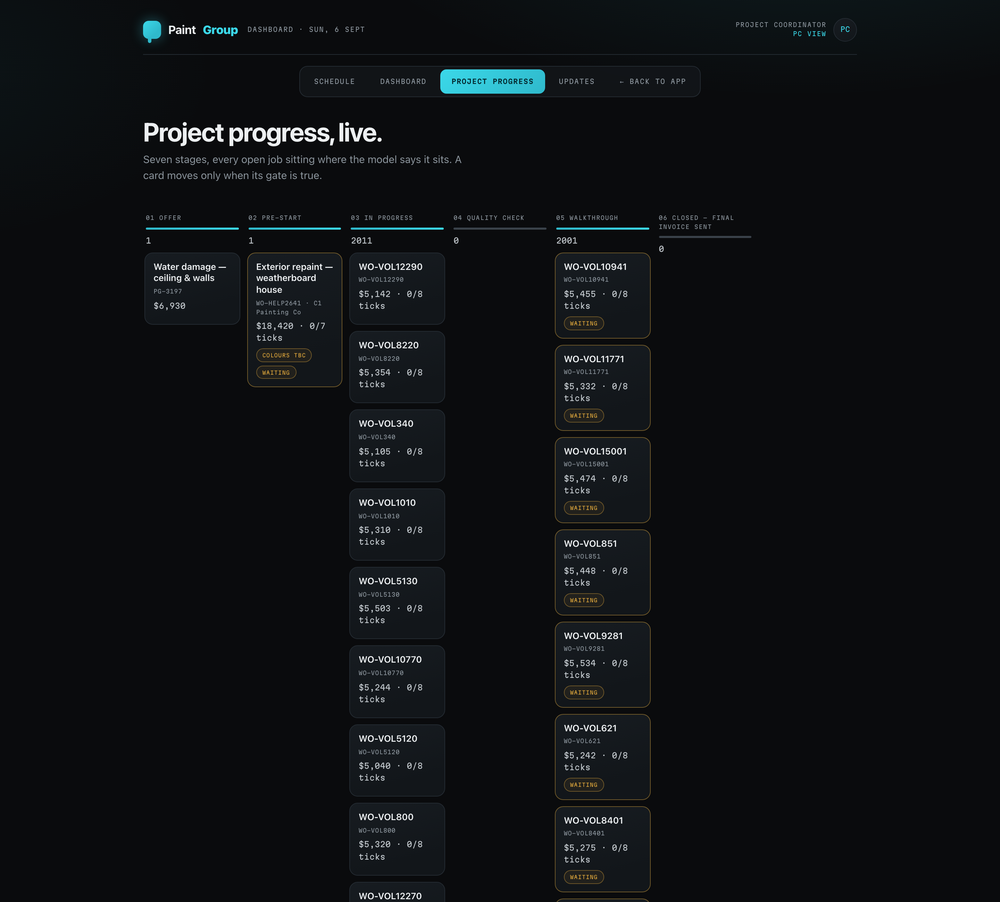
3. Open a job. The header carries the stage rail, the money line (contract inc GST, variations, contractor pay, estimated GP, deposit). **Variations** is what the customer signed for. **Contractor** is the painter's full pay for the job: the offer plus every variation they have accepted, including ones you approved for the contractor only, with "$5,040 + $1,203 variations" under it (since 14 Oct 2026). It matches what the painter sees on their job page. While a new rate you set in Revise scope is waiting on the painter, an amber line under it says so, for example "$6,831 waiting on Abdullah to accept $60/h → $67/h". The Contractor figure moves when they accept. On an employee job **Contractor** reads "—": the crew is paid by the day, not by the job. **Labour (employees)** is every booked Monday-to-Friday day of every employed painter on the job at hours × their cost rate — days ahead included, with "includes 3 booked days not yet recorded" under it — plus any extra hours logged; an amber line names a painter who has no cost rate yet (set it on Painters). **Est. GP** comes from the contract plus signed variations, less that pay and the employee labour, before materials and the view switch: **PC view**, **Painter's view** (the same tick list the painter sees, which you can tick on their behalf), **Edit job sheet**, **Revise scope**, **Payments** (the job panel: money in, money out and profit).
   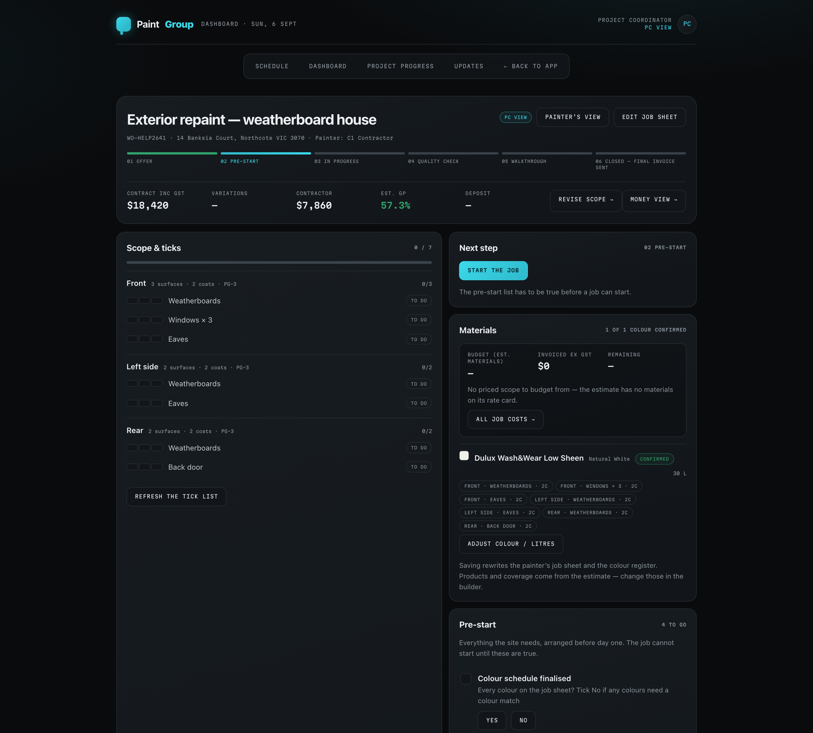

### What the estimator noted
Under the header, before the tick list, an **Estimator notes · internal** card lists everything the estimator typed or recorded about this job in the builder — dated, signed, voice notes with a player. Add your own note or recording here too; the estimator sees it in the builder. Internal only: nothing in this card reaches the painter's job sheet, the portal or the customer.

### Finding a project
3a. The search box in the top bar is on every console page — Schedule, Dashboard, Project progress, Updates, Timesheets. Type any part of the job's reference, its title or address, the customer's name, the estimate's title or its number (**42**, **#0042**). Matches drop down under the box with their stage; open jobs come first and closed ones are greyed. Click a match, or arrow to it and press **Enter**, to open the job's console page. **⌘K** (Ctrl+K on Windows) or **/** jumps to the box from anywhere on the page; **Esc** closes the list. "No project matches" means the words are not on any job; a line saying the read was refused means the search itself failed, not that the job is missing.

### Booking confirmed and Pre-start
4. Scroll to the **Pre-start** card (the counter reads **N TO GO**, then **ALL DONE**). It is the same card whether the job is **offered** to a contractor or **assigned** to an employee — the list belongs to the job, not to who is painting it, and it is built the moment the job is issued and again when a painter goes on it. Answer **Colour schedule finalised** with **Yes**, or **No** if any colour still needs a colour match, then tick **Materials ordered** (it needs the colours first), **Equipment movements booked** and **Access details recorded**. Under **Materials ordered** a **Paint estimate** lists every paint on the job sheet with its estimate litres, cost and order in cans, plus the total estimated paint cost ex GST. Change any of it on the **Materials** card. Under **Materials ordered** sit this job's **paint and materials chips** from the Movements board (one per brand, one per materials line — tap one to open it on the board) and the **materials list**: one line per thing the painter needs that isn't paint (caulk, filler, tape, sheets, a plank hire). It is the same list the estimate's internal Materials & sundries field and the Movements tray show; **Add** a line here and it is a chip in the tray. A line already on someone's day cannot be removed until its chip is back in the tray. The lines are **bubbles**: tap the words to edit a line, × removes it, and the × on an item inside a bubble with several items splits that item off into its own order; **Combine into one order** folds every line still in the tray into one. Once pre-start is ticked, or on any later stage, the same list and chips sit in their own **Materials & movements** card lower on the page, so a running job's orders can still be edited. Under **Equipment movements booked** sit the **gear chips**; type the gear you need in the **Gear needed** box (one line per chip, commas between items — *extension ladder, drop sheets*) and press Enter, or pick tagged items from the register on the board. A materials line is one order chip: write its items separated by commas on the one line (up to 500 characters); no shop is assumed for it — the office confirms the shop and delivery or pickup in the chip on the board. **The two ticks are real gates and they tick themselves** (since 24 Oct 2026): Materials ordered ticks by itself the moment every paint and materials chip for the job is off the tray — on a day or on the Supplier lane; Ordered ✓ on the board is the text to the painter, not the gate — or when you press **Not needed** / **Painter supplies**; Equipment movements booked ticks by itself once every gear chip is booked (or **Not needed**). While a chip is still in the tray the sentence under the item names it and where it is, and a hand tick is refused in those words. A chip dragged back to the tray does not untick what was ticked; the line under each item says what is still in the way. The old free-text boxes were imported as lines on 20 Oct 2026. The painter's job sheet shows the lines as "Getting it to site" — where to pick up, what is delivered — never the office's notes. **Pre-start checklist** and **SWMS / induction attached** are optional on a residential job; ticking the first emails the customer the pre-start checklist, and the second is required on commercial and body corporate jobs. An item that ticks itself is marked **auto**.
   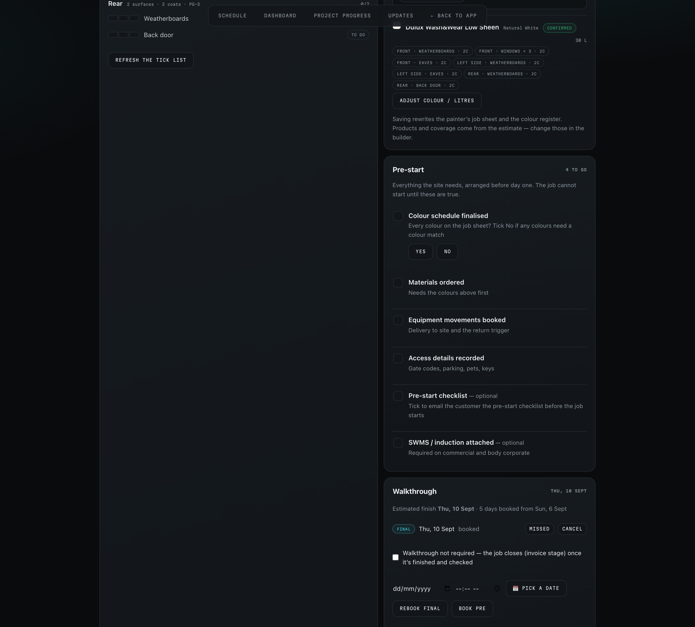
   At 2 pm on each business day you get a text if any job starting within 2 business days still has this card unfinished, and a **FINAL reminder** for jobs starting on the next business day (Settings → Staff logins → **Pre-start** decides who gets it).
5. When the card reads **ALL DONE** the job can start. Further down, under the job facts, tick **Quality check required** if this job needs a check regardless of the contractor's record (a new contractor's first three jobs get one automatically); **+ Add a site check-in** books your own extra visit on a day and time you choose (see *Site check-ins* below — it is not a quality check). **Quality check not required on this job** is the override the other way: press it for a job that should skip the check even though the contractor is new — any check already due comes off the books, the facts read **Not required — waived by the office**, and a job parked at Quality check moves on as a pass would. Ticking **Quality check required** turns the waiver off again; adding a site check-in does not.
   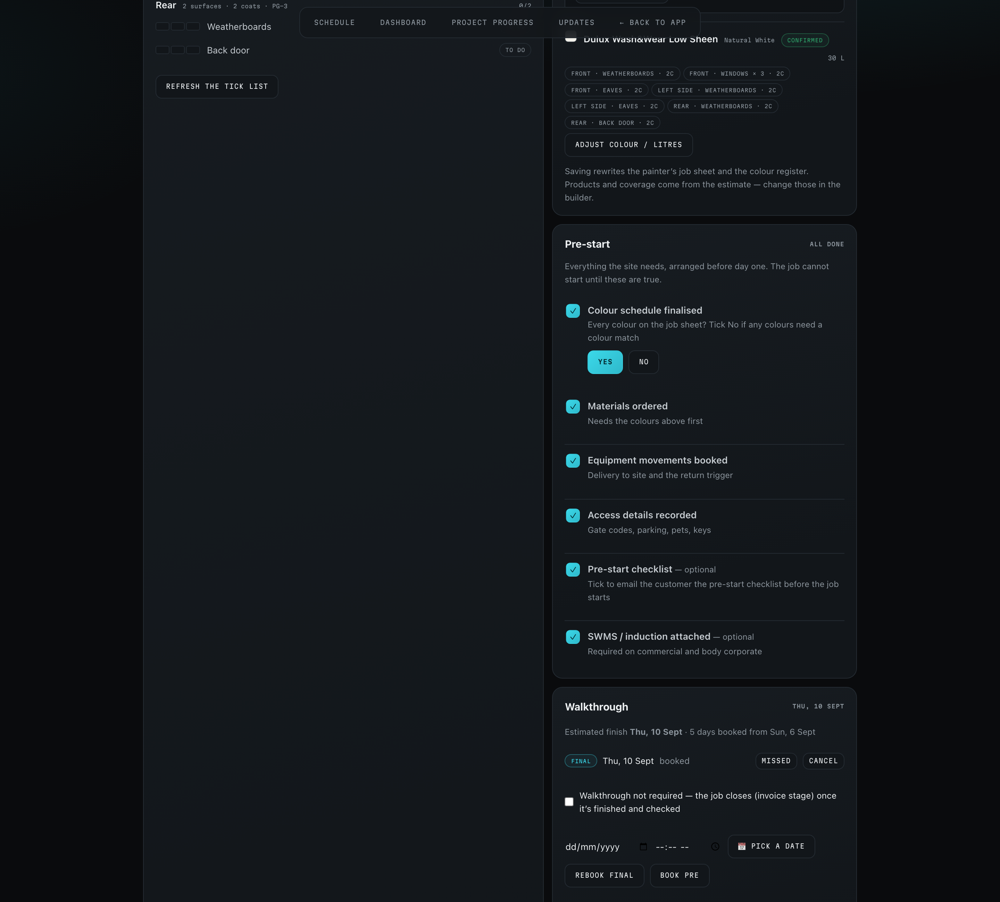
6. **Next step** offers **Start the job** once the list is true, with the gate's wording underneath while it is not. You can start early; the console warns that starting moves the start date to today and asks you to press again. Otherwise the job starts itself on its booked date once the list is done.
   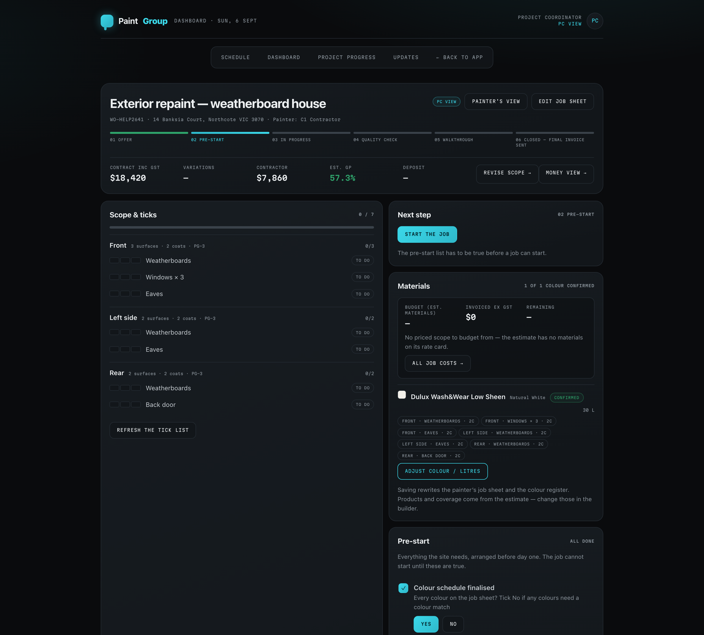
7. At **04 In progress** the **Scope & ticks** card shows the painter's list live — each counted item (doors, windows, posts) reads **Doors × 4**, the same count as the customer's estimate, on every job (filled in at issue since 15 Oct 2026, and older sheets were filled in once) — locked with a 🔒 line until the painter's Step 1 before photos are in (one batch for the whole job, since 30 Sep 2026). Under each line is a small **Photos not required — …** button: press it on a line that is not a surface (a fuel allowance, a site set-up line) and the painter is never asked for a before or finished shot of it; the row shows **No photos** and the button reads **Photos required again**. The same button sits on the read-only scope list before the job starts. The photo rule is per job: one batch of before photos unlocks every row, and one batch of after photos of all rooms or all sides is needed before the painter can finish — only a line you mark **Photos not required** is exempt.
   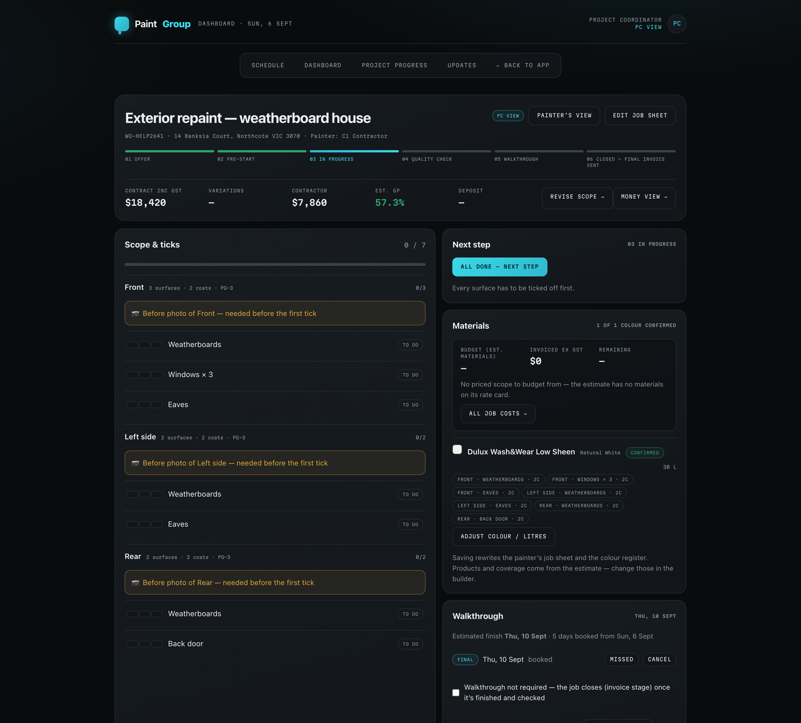

### Photos and videos for the painter
The **Photos and videos for the painter** card on the job page is how you put a picture in front of whoever is doing the work: the elevation the scaffold goes on, where the gear lives, the colour to match, the bit of the brief a sentence never quite carries — or the walk-round video a customer sent you on WhatsApp.

Pick the area it belongs to (or leave it on **Whole job**), type what the painter should notice, and choose the file — a photo (JPEG, PNG, WebP or HEIC, up to 25 MB) or a video (MP4 or MOV, up to 200 MB). To forward a customer's WhatsApp video, save it to your computer or phone first, then choose it here like any other file. It appears on their job sheet under **From the office**, above the scope, the moment it uploads — on their phone, in the portal, and on the job-sheet link. A video shows on the card as a small player so you can check it is the right clip; on the painter's sheet it is a tile with a play badge that plays full-size when tapped. A file that is not really a photo or video is refused with a message, nothing is filed.

This matters most on a **handover job from PaintScout**. Those come in without any of the estimator's photos, and the sheet's own photos are frozen at acceptance, so before this there was nothing to show the painter at all. On those jobs these are the only pictures of the job there are.

**Remove** takes one back off the sheet, photo or video. It only ever removes what the office added: the painter's own before, progress, quality-check and completion shots are their record of the work and the button cannot touch them — they live further down under **Site photos**. A painter can send a video as well as a photo from their Variations and Photos & notes cards: it appears as a tile with a play badge and plays full-size when tapped.

**Painter's view** on the job page shows the sheet exactly as the painter has it, photos included — check there rather than the builder's job-sheet tab, which is the office's copy.

A caption is worth writing. "Scaffold this side" on the right elevation saves a phone call; an uncaptioned photo makes the painter guess what they are looking at.

The card disappears once a job is closed — a closed job's sheet is final.

### The level of finish on a job that is already out
The **Level of finish** card on the job page says which PG standard this job sheet holds the painter to — **PG-2 Utility**, **PG-3 Premium** or **PG-4 Showcase** — and, in brackets, the level the job was priced at.

Those two can disagree. The level is frozen onto the job sheet when the job is issued, and changing it in the revision builder moves the **money** without touching the sheet: the painter goes on reading the standard the job went out with. That is what this card is for. Pick the level the job is actually being done to and **Save to the job sheet**; the painter's copy, the offer and the portal all change straight away.

Two things it deliberately does not do. **It does not change the price** — the level multiplier is priced and signed as a variation in **Revise scope**, so correcting the sheet here and sending the variation there are two separate jobs, and both need doing. And it leaves any area that carries a level of its own alone: the card names those areas before you save, and everything else follows the job. If an area was pinned to the level you are now moving the whole job to, it stops reading as an exception.

**Level 1** is not offered. It has no contractor standard, and calling a Level 1 job PG-2 would hold a painter to more prep than the customer paid for.

The card disappears once a job is closed — a closed job's sheet is final.

### Further instructions for the crew
The **Further instructions for the crew** card on the job page is the note at the top of the painter's work order — the key under the mat, which side to start on, the neighbour who needs warning. It is the same note as the box on the builder's work-order tab: write it in either place and the other shows it.

Type the instructions and press **Save to the work order**. The card says "Saved — the work order carries the new instructions." From then on the painter's job-sheet link, the crew link and their portal job page all show the new text the next time they open it. The painter is not sent a message about the change, so ring them if it matters today.

Clear the box and save to take the note off the sheet altogether.

If the card shows an amber line, "The painter's sheet currently says: …", the note was edited in the builder after the job went out and the painter never got it. Check the text in the box and press **Save to the work order** to send that version.

The card is read-only once a job is closed — a closed job's sheet is final.

### Changing a colour from our colour list
On the **Materials** card, **Adjust colour / litres** opens the row. **Choose a saved colour** opens our colour list, the same one the estimator uses in the builder: search by name or tap a brand, then pick a colour. That fills in the colour name and swatch. You can still type a colour name or hex by hand for anything that is not on the list, or use **+ Add a colour** to add it to the list for next time. Press **Save to job sheet** to send the colour to the painter's sheet.

### Paint estimate, cost and the order
Each row on the **Materials** card shows the order (**Order 13 L**) and, under the colour, a line like **Estimate 13.8 L · cost $234.60 ex GST · cans 10 L + 2 L + 1 L**. The estimate litres and cost come from the estimate itself, priced on its own rate card, the same figures that add up to **Budget (est. materials)**. The cost is only shown when the estimate has a priced scope. The order is the estimate rounded **down** to whole litres, at least 1 L, made up from 15 / 10 / 4 / 2 / 1 L cans.

Job sheets issued before 13 Oct 2026 rounded each paint **up** to the next tin, so 4.1 L became a 10 L can. Those rows show an amber **job sheet orders more than the estimate (conservative: N L)**. To fix one, open **Adjust colour / litres**, press **Use estimate, rounded down (N L)**, then **Save to job sheet**. The painter's sheet then shows the new order and cans.

The painter's job sheet shows the order, the cans and the estimate litres, and a **Materials for this area** list under each area. It never shows a cost.

### Variations for approval
The Dashboard's second section, **Variations for approval**, lists every open variation across every job: the ones **waiting on you** (raised, no price yet — amber, **Price it**) first, then those priced and waiting on the customer, then those the customer has approved and the painter has not yet accepted. The heading counts them ("3 open · 1 waiting on you"); each row names the category, the amount once priced, the job and the painter's words, and opens the variation on the job page. A declined, cancelled or accepted variation leaves the list on its own.

**Rejecting a painter's request** (since 8 Oct 2026). (Until the 12 Oct 2026 fix every Reject failed with "Couldn't reject that just now" and nothing was saved or sent — reject any you tried again. The same fault stopped painters declining a client-approved change; those changes are still waiting on the painter.) A row waiting on you also has a **Reject** button. Press it, write your reply to the painter in the box — why it isn't going ahead, or what you'd need instead — and press **Reject and send reply**. The variation is closed as declined (it can only be rejected while it is still with you; once priced it is the customer's to answer), and your reply goes to the painter who raised it by text and email. The row then says in words what happened: "Rejected — texted and emailed your reply to Jacob", or "Rejected — but your reply didn't reach Jacob" with the reason (most often no mobile or email on file — fill those in under Contractors and ring them). The painter's job page reads **Not going ahead** with your reply; the variation card on the job page here shows "Rejected by the office" with the same words. The same **Reject** button is on a raised variation's card on the job page.

### Pricing a variation
8. A raised variation appears on the job as a card with a five-step rail: **RAISED → PRICED → CUSTOMER → CONTRACTOR → WORK**, the painter's words, their photo and their hours estimate. It also lands in the queue as **Variation waiting on a price**. Choose **Price it in the builder — working scope** for anything with materials or several lines, **Quick price — hours only** for a small labour-only item, or **Approve for the contractor only — no charge to the client** when Paint Group is absorbing it.

8a. **Price it in the builder** opens Revise scope *for that request*: a blue line at the top of the changes panel reads "Pricing Qudrat's request: …" in the painter's words. Make the change in the scope and **Save & draft variations for signature** — the addition you draft **becomes the painter's request** (since 7 Oct 2026, 12A Cavell Court): the same card on the job moves from RAISED to PRICED, the painter's portal reads **With the customer**, and there is never a second variation beside the first. The painter's words stay on the record, followed by the change's title. Back the change out of the scope before the customer signs and the request simply returns to RAISED. (Before the 12 Oct 2026 fix the builder still drafted a separate row and the painter's request sat at RAISED, and the blue line never appeared — if you still see one of those, cancel it against the priced row.)
   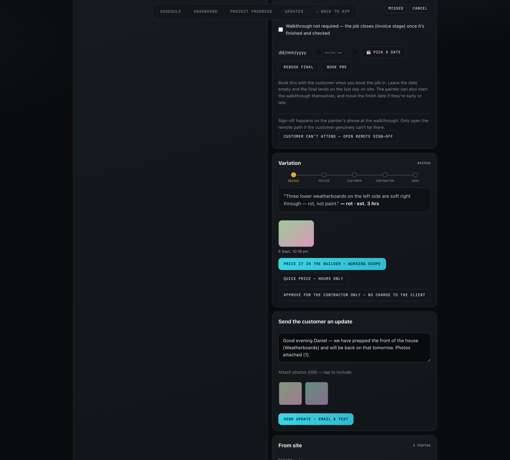
9. Quick price: enter the hours and any materials. The preview shows the customer price from the pricing engine and the contractor's amount.
   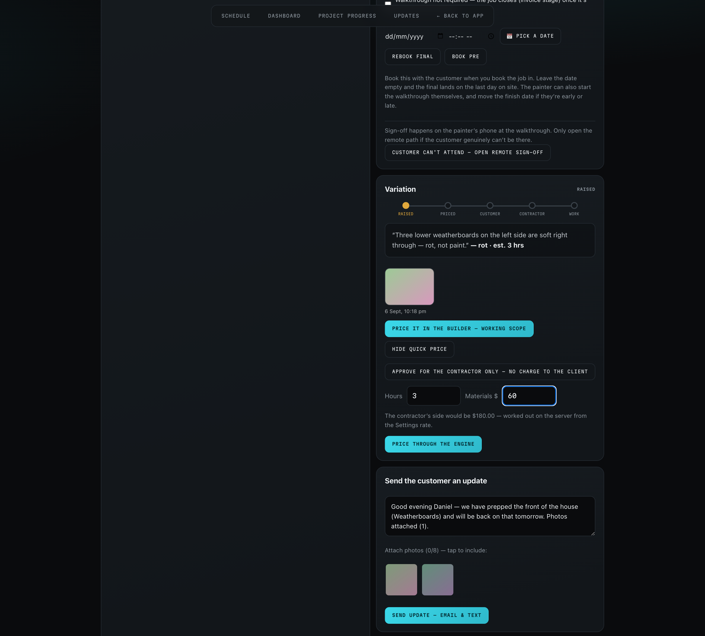
10. Priced, the card reads "with the customer" with the amount, and the signing link has been emailed. **Text the link** or **Both** if the customer prefers. **Set contractor amount** overrides what the painter receives. The queue card **Variation priced, customer silent** appears if they do not answer.
    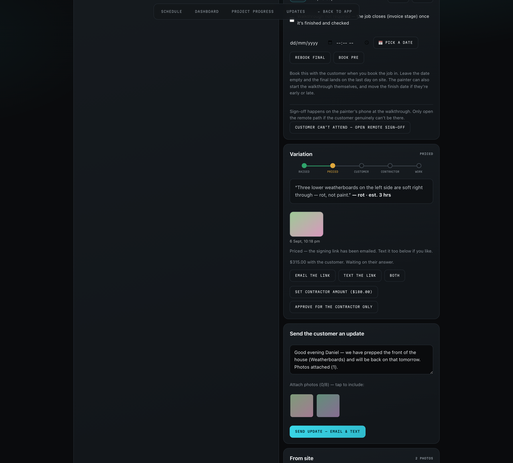
11. The customer approves by signing the link. Under **Settings → Automations**, "Approved variations go straight to the painter" is on by default, so the painter sees it as **YOUR APPROVAL** straight away and accepts; the rail reaches **CONTRACTOR** then **WORK**. If that automation is off, a **Release** step appears here for you. The customer is emailed a confirmation the moment they sign (since 8 Oct 2026): the changes they approved, what each adds or takes off, the new total and who signed, with a link back to the signed page. It goes to the estimate's contact email (and the second contact, if there is one); the email is on their CRM record, and the job's record says whether it went or why not — no email on the contact, or the customer has switched job emails off in their account. Their signing page says "We've emailed you a confirmation" only when it went. A removal signed after work started raises **Pay adjustment needs you**: enter the deduction and why; the painter sees your note.

### Changes from Revise scope — one offer, one signature
11a. Changes made in **Revise scope** (the working scope) go to the customer as **one offer**. Edit the scope, then **Save & draft variations for signature**: the panel shows one row — "2 changes · one offer for the customer" — with the net figure (additions minus removals, inc GST) and the two changes listed under it. There is one **Copy signing link** and one **Email / Text / Both** for the whole offer; draft five changes and it is still one link. Every addition needs a photo before the offer can be sent (a removal does not); the send button stays off until each one has one.

**Undo or revise one change** (since 12 Oct 2026). Every row in **Changes vs the accepted estimate** has its own **Revise** and **Undo change** buttons. **Revise** opens that area or line item (or, for *Pricing adjustments changed*, scrolls to **Job settings**) so you can correct it. **Undo change** asks once, then puts *that section only* back to how it was on the accepted estimate and saves the working scope — the row disappears and every other change stays where it is. Undo works on additions (the area goes), removals (the area comes back in its old place), changed areas, and the job-level settings (discount, condition, materials, rates, Preparation). It only touches the working scope: a change already drafted and sent to the customer is not withdrawn by it.

An untouched job reads **The working scope matches the accepted estimate**. Before 12 Oct a job with **Preparation hours** on it (28 Logan St) showed a false *Pricing adjustments changed · 4 hr* line with nothing edited — that was the panel's preview leaving the Preparation hours out of its comparison; nothing in the job had changed, and drafting would have found nothing to send.
11b. The customer opens the link, sees every change with its photos and lines, the total for the lot, and their job total before and after. They **Approve all** with one signature, or **No thanks** declines the lot — the changes are never approved one by one. Once answered, the same link shows the outcome.
11c. Where the changes go next depends on whether anyone is on the job yet. **No painter on the job** (not offered, not assigned): the moment the customer signs, the job sheet **becomes** the new scope (since 12 Oct 2026) — added areas are on it, removed ones are gone, the hours follow — and the changes are not listed beside it, so the painter you offer it to sees one scope and one price (the base pay plus those changes, as one figure). The changes still show on this console and on the job panel in Payments. A change drafted before 12 Oct keeps the old behaviour: listed as **In the job** beside the old sheet. **A painter already on the job** (since 7 Oct 2026): each signed addition goes straight to them for **their approval** — their job page shows **Variation approved by the client** with the amount and the estimated hours, a big **Accept** and a small **Decline**. They are told by text **and email** (Settings → Automations → *Variation waiting on you*); a painter with no mobile on file is emailed. The variation card here reads "Released — waiting on the contractor to accept" with a **Remind the painter** button that sends it again and says in words what went out — or "Nothing went out — No email or mobile on file", which means the painter's contact details need filling in under Contractors before anything can reach them. Accept and the rail reaches **CONTRACTOR** then **WORK**. Decline asks them "please advise us of any further changes"; their note comes back to you as a **Painter declined an approved change** card on the console, an email and text to whoever has **Change declined** ticked in Settings → Staff alerts, and a line on the variation card here. The change no longer holds the job's gate; revise it with the client in Revise scope, or set the painter's amount and send it again. A removal is acknowledged, as before. Either way the painter's job sheet now lists **Changes to the scope** — what was added or removed, with hours, never the customer's price (a contractor's crew copy carries no hours at all, since 21 Oct 2026) — and every approved addition with site hours is also on their tick list: a new area under its own heading with a row per surface, a raised variation as one row under **Variations**. Those rows count toward progress and the finish gate like any other. A change with no hours (a price-only adjustment) adds no row.

11d. **Hours go to the customer; the contractor's RATE does not** (since 13 Oct 2026). Any change to the contractor's **hours** in Revise scope goes to the customer to sign first (**Save & draft variations for signature**), even when the customer's price does not move — then, with a painter on the job, to the painter to accept (step 11c). Saving alone never sends hours to the painter. A change to the contractor's **hourly rate** (Calculations → *Contractor rate*) never goes to the customer: before anyone has accepted the job the contractor's price simply follows on Save; once a contractor has the job, Save sends them **Change to your rate** — the old and new rate and their pay for the job, before and after — to **Accept** (their pay moves, and so do the changes they had already agreed) or **Decline** with a note (their pay stays at the agreed rate; whoever has **Change declined** ticked in Settings → Staff logins is told). Setting the rate back to the agreed one before they answer withdraws it. The save message says which: *contractor's price updated*, *new rate sent to the contractor to accept*, *new rate waiting on the contractor*. The new rate applies once to each hour: changes you drafted after setting the new rate are already priced at it, so the painter's "after" figure only adds the difference on the hours still at the old rate (since 14 Oct 2026). A rate you changed on a job a painter already had **before 13 Oct** reached nobody — open **Revise scope** and press **Save** once to send it. (On 12 Oct, hours-only changes briefly skipped the customer; those the painter had not answered yet were cancelled on 13 Oct — draft them again with **Save & draft**.)

11e. **The reminder before saving.** If a save in Revise scope would change the contractor's hours or their hourly rate, the builder asks first and says where it goes — *"Contractor hours have changed: 40.0 h → 44.0 h. Hours go to the customer to sign first, then to the contractor to approve"*, or *"The contractor's hourly rate has changed: $60/h → $65/h. This does not go to the customer…"*. **OK** saves; **Cancel** saves nothing. The same question comes up before **Save & draft variations for signature**.

11f. **The office is told when the customer signs** (since 12 Oct 2026). Every staff login with **Change approved** ticked under Settings → Staff logins gets an email (or text) listing what the customer approved and the net figure. Wording: Settings → Automations → *Customer approved a change*. Nobody is ticked to start with — tick it for the Office login (info@) to get it there.
11d. Drafting again after a signature drafts only what goes beyond it, and joins any offer still waiting on the customer; a change that nets back to nothing retires its draft.

### Customer updates from the painter's ticks
12. Each day's ticks and photos become a drafted customer update. **Updates** lists **Updates waiting on you**; read it, edit if needed, then **Approve & send**. Since 21 Oct 2026 the draft is laid out in short sections the customer can scan rather than one long sentence: **Hi <first name>,** then *Here is today's progress (Tuesday 21 October):*, a **Finished today** list (one bullet per area — *Front of the house: walls (weatherboard and render), 3 windows and entry door*), a **Prepped and ready for paint** list where the day earned one (*… — we will be back on these tomorrow*), *6 new photos are on your job page.* when photos landed, and the sign-off *Any questions, just reply to this message. The Paint Group team*. The painter's tick labels are turned into plain words (*Windows × 3* becomes *3 windows*). A section the day did not earn is left out. The email prints the text as written, line breaks and all; the **text message** carries the greeting line and the Finished/Prepped bullets on one line, without the sign-off, with the link to their job page. There is no "Good morning"/"Good evening" (dropped 14 Oct — it was wrong whenever the send came later than the tick), and the email and text carry the draft's greeting rather than adding their own. Under the job's title a line says **Painter's last update to this job: Tue 14 Oct, 3:42 pm** — the newest tick the draft was written from, Melbourne time — so you can see how fresh the words are before you send them; a draft with no ticks behind it (written by hand) says **No tick on record**. Nothing goes to the customer until a person approves it. A draft that will never go — the job has since completed — has a **Delete** button (press twice; the second press confirms); the removal is logged on the job. When any drafts sit on completed jobs, a card at the top says how many and **Delete them all** clears them in one press. A sent update cannot be deleted; it is the record of what the customer received. On the job page, **Send the customer an update** comes pre-written from the latest ticks with the site photos ready to attach; tap up to 8 photos (the button reads **Send update + 2 photos — email & text**), edit the words and tap it. The photos you tapped go in the email and are recorded on the update, so the customer sees exactly those on that update in their portal (**Your project, day by day**), whatever day they were taken (since 14 Oct 2026 — before that the portal showed only photos taken the day the update was sent). An update approved from **Updates** carries no photos of its own; that day's site photos still sit under it.
    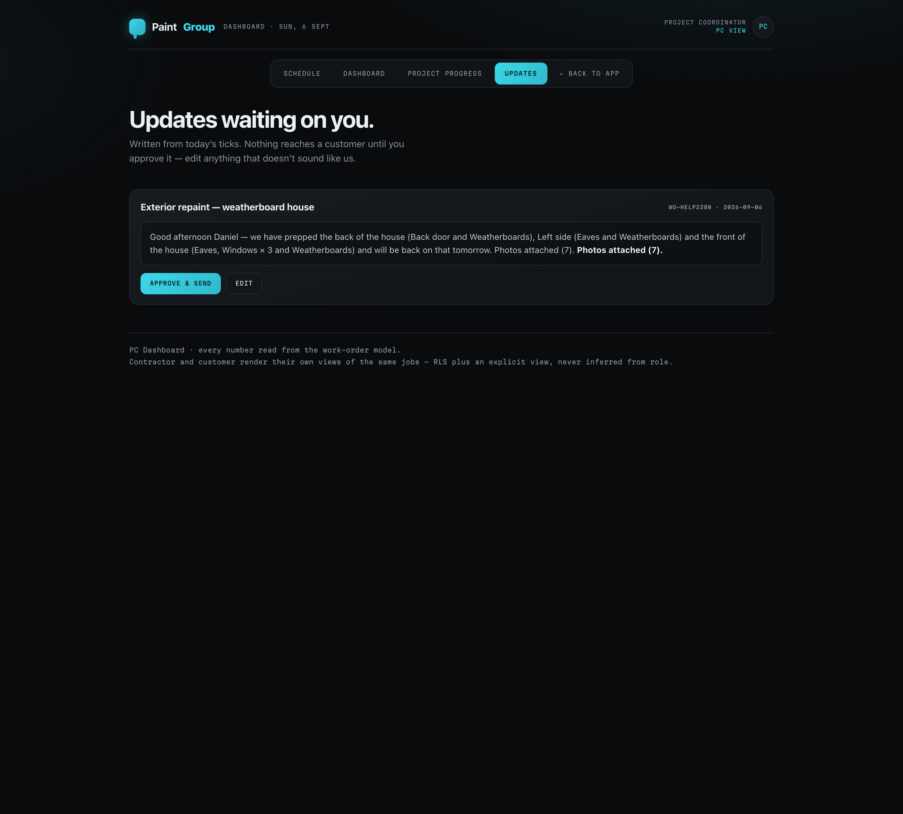

### Telling the office, and logging what the client was told
12c. **You are told when there is something to send.** The moment a painter's ticks draft a customer update (or the evening sweep catches one), whoever has **Update ready** ticked in Settings → Staff alerts gets an email and a text with a link to Updates — once per job per day. **You are reminded when the client is due one.** Each evening the sweep looks for jobs in progress whose customer has had nothing for the "update every N days" setting with nothing drafted, and emails and texts whoever has **Update due** ticked — once per job per day while it stays due. Tick both channels on Felipe's login (Settings → Staff logins → the alerts matrix) for these to reach him; a login with no phone gets email only.
12d. **Client updates** on the job page is a notes box for what the client was told by hand — a call, a text, a conversation on site. **Log it** writes the note to the job's timeline and, when the job has a customer record, to that customer's CRM record as a Note ("Client update: …", with your name). The timeline under the box lists every update sent to the customer and every note logged here, newest first.

### Moving a job on from In progress yourself
12a. The **Next step** card on an In-progress job now starts with **Before the next step:** — a short list of what the one routed button needs, each line ticked ✓ or open ○: every surface ticked off, the after photos (the painter's Step 3), the finishing-up list answered, and any variation still waiting on a decision. Fix the open lines in that order, then press **All done — next step**. The press runs the painter's own finish and routes the job: **05 Quality check** if a check is due, otherwise the walkthrough (or straight to closed on a *walkthrough not required* job). Anything still in the way comes back in words under the button, never as a code.
12b. **After photos missing, every box ticked.** The painter's finish needs the job's after photos — one batch of all rooms or all sides — and until 6 Oct 2026 the console had no way past that: pressing the button answered "not at prep" and nothing moved. Now the card offers two routes once the ticks are done: **Upload after photos** (if the painter has texted them to you — they land on the job as the after photos and the job can move) and **No after photos coming — move on without them**, which asks for a reason, puts an *after photos waived* entry on the job's record with your name, and lets the same button move the job. The painter's own rule is unchanged: only the office can waive.

### Quality check
13. When the painter taps **All done — next step**, the server routes the job: to **05 Quality check** if a check is due, otherwise straight to the walkthrough. Checks are due on a new contractor's first three jobs and on any job where you ticked **Quality check required**. A site check-in is never one of them — it holds nothing. The check appears on the job as a **Quality check** card ("Photo-logged against the standards. Every line looked at before a pass.") with the four standards: **Cut lines**, **Coverage**, **Prep evidence**, **Site**. The queue says **Quality check to do**. Tick each standard as you inspect it; the pass button reads **N standards to check** until all are ticked.
    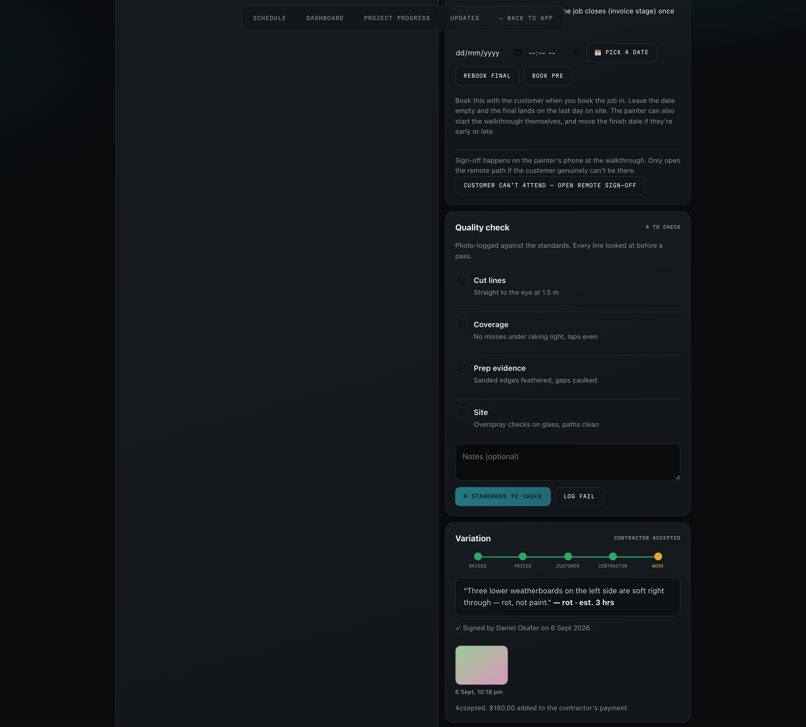
13a. **What we expect on this job**, the closed drop-down at the top of the job page, is the same document the painter has and the list you use at the check. Tap it once: each finish standard on the job appears once at the job's level, with the rooms it covers and its checks, and **Open the full standard ›** for the page (see [the finish standards guide](../standards/pc.md)). Tap the heading again to close it.
13b. **The check does not wait for the painter to finish** (since 22 Oct 2026 — Tom: "so we can quality check before a job is finished"). Every check on the job is on its page from **04 In progress**, the moment it is scheduled (ticking **Quality check required** schedules it at once). While the painter still has boxes to tick the card reads **Quality check · before the finish · N to check** with a line under it: *The painter hasn't ticked every box yet. Log it now all the same.* Work it exactly as in 13 and 14. A **FAIL** logged mid-job puts the rectification on the painter's tick list straight away and the job stays at In progress (there is nothing to send back). A **PASS** logged mid-job is recorded and moves nothing — the message reads **Passed — logged before the painter finished. Nothing else to check: when they tick the last box and finish, the job skips the Quality check lane and the office signs it off** (or says how many checks are still to log). When the painter then taps **All done — next step** the job goes straight to **06 Walkthrough** (or closes on a *walkthrough not required* job), and because a check on it passed, it is yours to sign off (17). Before 22 Oct an unlogged main check was not drawn until the painter had finished; only a dated site check or spot check on its day was.

14. To fail it, tap **Log fail**, enter **Where** (the area) and what needs putting right, add **Photos of where it failed — show the painter**, and tap **Log fail — raise rectification**. The check is logged **FAIL**, the job returns to **04 In progress**, and the item lands on the painter's tick list marked **Rectify** under the area you named. The failed card stays on the page as the record — **Logged: FAIL · re-check scheduled** — and Job facts lists the re-check as **due**.
    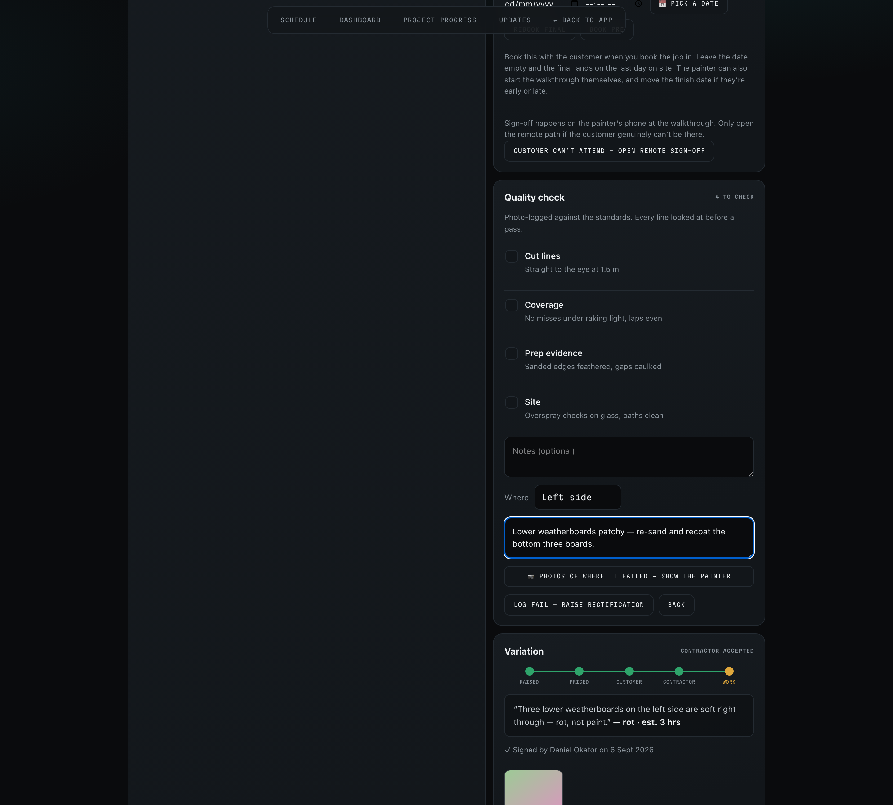
15. When the painter has put it right and finished again, the job comes back to **05 Quality check** with two cards: the failed check, still **Logged: FAIL** with no buttons, and a fresh **Quality check re-check** card with all four standards unticked. Work the re-check card: tick each standard as you inspect the fix; when every one is ticked it reads **READY TO LOG**; add a note and tap **Log check — PASS**. (**+ Add a site check-in** is for an extra inspection, not for this — the re-check is scheduled by the fail itself.)
    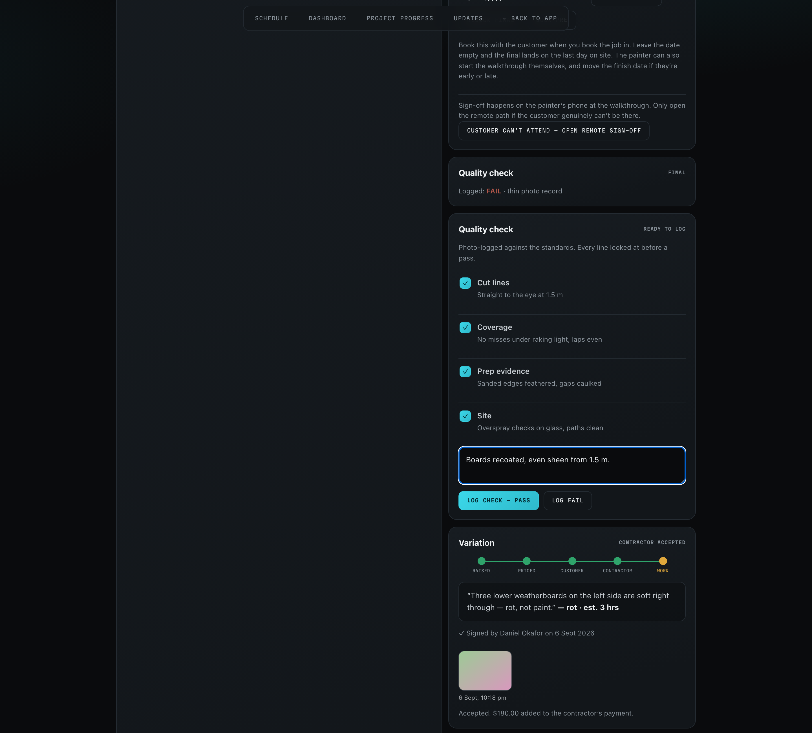
16. A pass with no other check open moves the job on by itself: the customer's evidence pack is delivered and the stage becomes **06 Walkthrough**. A job that reaches Quality check with **no check on it at all** (the checks were turned off or removed after it arrived) also moves on by itself the next time anyone opens it or the evening sweep runs — until 7 Oct 2026 it sat there for good (25 Bunney Road). **Quality check not required** on a parked job now means it: a logged FAIL with no re-check (one logged before 24 Sep 2026, when re-checks arrived) no longer holds a waived job — the fail stays on the record and the job moves on at the next view or sweep; turning the check back on puts the fail back in force. If a job still will not leave Quality check, the reason is on its page: a variation still waiting (approve, decline or release it), colour-match codes missing, or — on a *walkthrough not required* job — a check not yet logged; `node scripts/diag/wo-next-step.mjs "<address>"` prints the same verdict. **Since 21 Oct 2026 an open check no longer holds the pack**: the painter can start the walkthrough from Quality check themselves (the job moves to **06 Walkthrough** and records *walkthrough before QA*), and **Send the pack to the customer** on the Next-step card goes through too. The check stays open on the job and is logged as usual — a pass on a job already at the walkthrough is recorded and moves nothing. What an open check still holds is the straight-to-closed path of a job with no customer walkthrough. A logged FAIL counts as open only until its re-check exists; once the re-check passes, the fail is history and holds nothing. If the re-check fails too, the same thing happens again — a further re-check, as many times as it takes.

16b. **Which jobs get a check is decided by the painter's status** (from 8 Oct 2026): a **New** painter's first jobs, a **Yellow** painter's every third job, every job for **Orange** and **Red**, and none automatically for **Green** — a Green painter is checked only when you choose. **Start quality check** on the quality-check card (since 23 Oct 2026) runs one now, whatever the schedule says: if a check is already booked for another day or time it takes you to that check's card to tick and log (the booking never holds it), and if none is booked it adds a spot check this moment and the card appears below (it clears a waiver). **Quality check required** on the job and the every-job setting still win. The status itself is on **Contractors** in the console rail — every painter's light, checks, app updates, call backs and streak; it is recomputed every half hour from checks, update texts and call backs on signed-off jobs, and a job counts seven days after its sign-off (see [the Contractors guide](../pc-contractors/pc.md)).

### When the check happens — the quality-check calendar
16c. **Every check has a day and a time, before the final walkthrough** (Tom, 8 Oct 2026). Under **Job facts** each check is a line — **Quality check · 2026-10-15 09:00** — with **Set day & time** (no day yet) or **Move**. Pick the day and the time and press **Save**. It has to be before the final walkthrough shown under the list (**Final walkthrough … — every check has to be before it**): a later day, or a time on the final's own day that is not earlier than the walkthrough, is refused with "A check has to be before the final walkthrough". **Take out of the calendar** clears the day.
16d. **The calendar invite.** Whoever has **QA invite** ticked in Settings → Staff alerts (email only — it is a calendar entry) is sent each dated check as a calendar invite: *Quality check — 12 Smith St (WO-1234)* on that day and time, with the painter and the final walkthrough in the description. Move the check and the same entry is updated; take it out of the calendar (or press **Quality check not required on this job**) and it is cancelled. Under each check a line says what happened: **Calendar invite sent to Felipe Martinez …**, **Taken out of …'s calendar**, or **No calendar invite — nobody is ticked for "QA invite"** — tick it on Felipe's login for the invites to reach him. A failed send is retried by itself (at most once an hour, and every morning).
16e. **At booking.** When the painter accepts the job, the job's checks are worked out there and then (a new painter's first three jobs, **Quality check required**, the status colours in 16b), and the main check is put on the **working day before the final walkthrough at 9:00** — Monday to Friday, skipping the public holidays in Settings → Booking rules. A Friday final puts it on Thursday; a Monday final on the Friday before. If no final is booked yet, the job's last booked day stands in for it. The invite goes out the same moment.
16f. **The final moves, the check moves.** Rebook the final (here, on the board, or the painter moving their finish date) and the main check moves to the working day before the new date, keeping its time; the invite is updated. A re-check and a site check-in stay where you put them. **If the final is cancelled and not rebooked**, the check is left where it was and PC Command shows a **Check · final cancelled** card: rebook the final and the check follows it, or move the check here.
16g. **Site check-ins — your own visits, only the office sees them** (Tom, 9 Oct 2026: "logged just for Felipe"). **+ Add a site check-in** (under the quality-check controls) books an extra visit while the job is running: a day and a time, before the final. It goes in the quality-check calendar like the main check — and nowhere else: the painter is not told, the customer is not told, and it is **never a pass or a fail**. It never holds a job up: the job finishes to the walkthrough with a site check-in still open. (Adding one also leaves **Quality check not required** as it is.)
16g-ii. **A required check at the top of PC Command** (Tom, 19 Oct 2026: "visible at the top of the page in PC command to book in the quality check before the final walk through"). From the moment a job needs a quality check until the check's day, a cyan **Quality checks to book in before the final walkthrough** strip sits at the top of PC Command, above the tiles, with one line per job. The line says where the check stands — **Quality check required — no day booked yet** (**Book the check** opens the job at the check), **Quality check pencilled for … final walkthrough not booked** (the check is sitting on the job's last day; **Book it in**, or book the final and the check follows it), or **Quality check … before the final walkthrough on …** (**Open the check**, and **Confirmed** puts the line away until the date moves). A job that has not started shows only once it is inside the Pre-start lane's week. On the check's day the line becomes the card in 16h, and a job parked at Quality check shows the console's own card instead; recording the check clears it.
16h. **On the day**, PC Command shows each quality check as a card — **Quality check today at 09:00 — 12 Smith St** — and it turns red once its time has passed. **Record the check** opens the job at the check: tick the standards and log it, and the card goes. A job already parked at **05 Quality check** shows the console's **Quality check to do** card instead. A site check-in has its own card — **Site check-in today at 13:30 — …** (**Site check-in · today**, or **not marked visited** once the day has gone) — with **Open the check-in**.
16i. **On the job page, the Site check-ins card** lists each visit with its day and time, the calendar-invite line, and **Mark visited** — that is what clears its PC Command card (adding a note does not). Until it is visited you can **Move** it, and **Remove** one booked by mistake (only while it has no notes).
16j. **Progress notes and photos.** Under each visit, write what you saw in the note box, pick any photos (photos only — JPEG, PNG, WebP or HEIC, up to 25 MB each), and press **Add note**. Notes are listed with who wrote them and when. A note is **office only** unless you tick **Send to the painter (name) — it goes into their Messages on this job, photos too, and they're told there's a message** before adding it, or press **Send to the painter** on it later. It goes to the job's lead painter (the contractor on the job, or the lead on an assigned job) as a message from the office in the job's **Messages** box — the same conversation as anything else you write to them, and they are texted the same way (one text per 10 minutes). Under each note a line says what happened: **Office only — the painter has not been sent this.**, **In the painter's messages since … Texted and emailed to Marco.** (or *Outside sending hours — …*), or **Not delivered: …** with the reason — press **Try sending again** after fixing it. Sending a note twice never sends it twice. The customer never sees any of it.

### App updates and "No work today"
16a. On a job under way the **App updates** card lists the painter's reminder moments — day 1 at 7:30 am, then by length — each **Upcoming**, **Due today · N sent**, **Answered**, **Missed · N texts** or **Skipped**. The painter is texted up to three times on the day until a tick or a photo lands, and on each 3:30 pm day also gets a 7:30 am heads-up that today is an update day (not once the day is answered or marked No work). A rained-off or locked-out day: pick the day (today or a past day), say why, and press **No work that day** — its moments are skipped and never counted, texts sent or not. **Clear** puts the day back. The same control is on the schedule board's block detail for a job under way.

### Checking in with the customer
16b. PC Command lists the customer check-ins for you, at the top of its queue (moved there from the CRM's Today on 6 Oct 2026), worked out from each booking's length in the painter's working days. A **3–6 day job** puts a **Check-in** card on the day half way through ("mid-job check-in, 50% through, day 3 of 5"), due by 5 pm; a **job of 7 days or more** gets two, at 35% and 70%. These rank high — a customer with a question mid-job is who the call is for. A **1–2 day job** gets a **Follow-up** card instead, due the next business morning after its last booked day: ring and check they are happy. Each card has **Open the job**, **Rang them** (the card goes for good) and **Tomorrow** (nobody picked up — it comes back the next day); both are recorded on the dismissal log like any Today item. The painter is texted to update their work order on the same rhythm. The CRM's Today and tab badge no longer count these.

### A variation still open at the finish
16k. Since 19 Oct 2026 a variation at **raised**, **priced** or **waiting on the customer** holds a job only while a surface in its scope is still to tick. With every surface ticked, the painter's finish and the walkthrough go ahead; the job's **Before the next step** list shows the variation as a note — *1 variation still waiting on a decision — not holding the walkthrough now every surface is ticked* — and it stays on **Variations for approval** for you to price, release or decline. An undecided variation is never put on the final invoice; decide it before you invoice, or afterwards as its own line.

### Walkthrough and sign-off
16b. **The job title** at the top of the page starts as the address; the pencil beside it opens a box to change it (Interior, Exterior, stage 2…). It changes the working scope's title, the Movements tray and the painter's sheet heading; the estimate keeps its own title.
17. At **06 Walkthrough** what the **Next step** card offers depends on the job. **A job that went through a quality check is signed off by the office, not the customer**: the button reads **Sign off as complete — quality check passed**, and the **Walkthrough** card carries the same button with an optional note for the record. Pressing it approves every area on the customer's behalf, signs with your own name, freezes the report, starts the warranty, drafts the final invoice and closes the job; the customer is not asked to sign and is not sent reminders — they receive the completion report the moment it is signed. The painter's page shows **Quality check passed — Paint Group signs this job off from the office** instead of the walkthrough button. On a job with **no** quality check the normal path stands: the customer signs on the painter's phone, and the Next-step button is the office closing the job on their behalf. The **Walkthrough** card shows the estimated finish and the booked **FINAL** walkthrough with **Missed** and **Cancel**; pick a date and time and **Rebook final** to change it (an empty date lands on the last day on site), or **Book pre** for a pre-walkthrough. A final is booked, rebooked or moved whether or not a quality check on the job is open (since 21 Oct 2026 — Tom: book the final walkthrough even if a quality check is required; until 8 Oct 2026 every booking answered *Quality check first*, and until 21 Oct the FIRST final on a job with an open check still did). The check follows the final to the working day before it (16e). Moving the date never signs the job — sign-off still waits for the **06 Walkthrough** stage. The **Walkthrough not required** button (on the Walkthrough card from the offer stage onwards, so it can be pressed the moment a job is approved or whenever circumstances change) means the job closes at the invoice stage once it is finished and checked; it reads **Walkthrough not required ✓ — require it again** while it is on. If the job is already at the walkthrough stage when you press it, the **Next step** card changes to **Close the job — no walkthrough required**: pressing that cancels any booked walkthrough and closes the job with the same report, warranty and invoice draft a signing would write. Under **Sign-off from our side**, **Walk through on this device** runs the customer's walkthrough on your own screen when you are with them, and **Customer signs here** (since 23 Oct 2026; was *Record sign-off manually*) is for a customer standing with you: type their full name, hand them the device and they draw their signature in the box — the same pad as their own link — and the drawn signature is kept on the report. Tick **The customer is not here — they approved by phone or on paper** to record an approval without a signature instead, with a note on how they approved. Once a job is signed, a **Signed walkthrough** card stays on the job page: who signed, when and how (on their own link, on our device, recorded by the office, or completed after rectification), their drawn signature, and **Open the signed walkthrough →**, which opens the frozen report at the customer's own link in a new tab. **Customer can't attend — open remote sign-off** opens the customer's own link for signing early, and **Send to the customer to sign remotely** (since 22 Oct 2026) does that AND sends them the link by email and text — the same words as the sign-off reminder, saying the walkthrough was done without them and asking them to look through the photos and sign. **Walk through on this device** is offered from the moment the job is under way — **04 In progress**, finishing up and **05 Quality check** — before any check has passed (since 23 Oct 2026): starting it sends the completion pack and moves the job to the walkthrough while an open check stays open for the office. From In progress only the office can start it (the painter ticks every surface first); from finishing up the prep list must be ticked, and the button says so in words if it is not. The customer signs by drawing in a signature box (the same pad as the estimate), never by typing a name; the sign-off is recorded in the name the job was booked under. Their own link can sign on its own once no final walkthrough is booked ahead of today — while one is still booked, the page tells them sign-off happens at the walkthrough and to call us if they can't make it.
    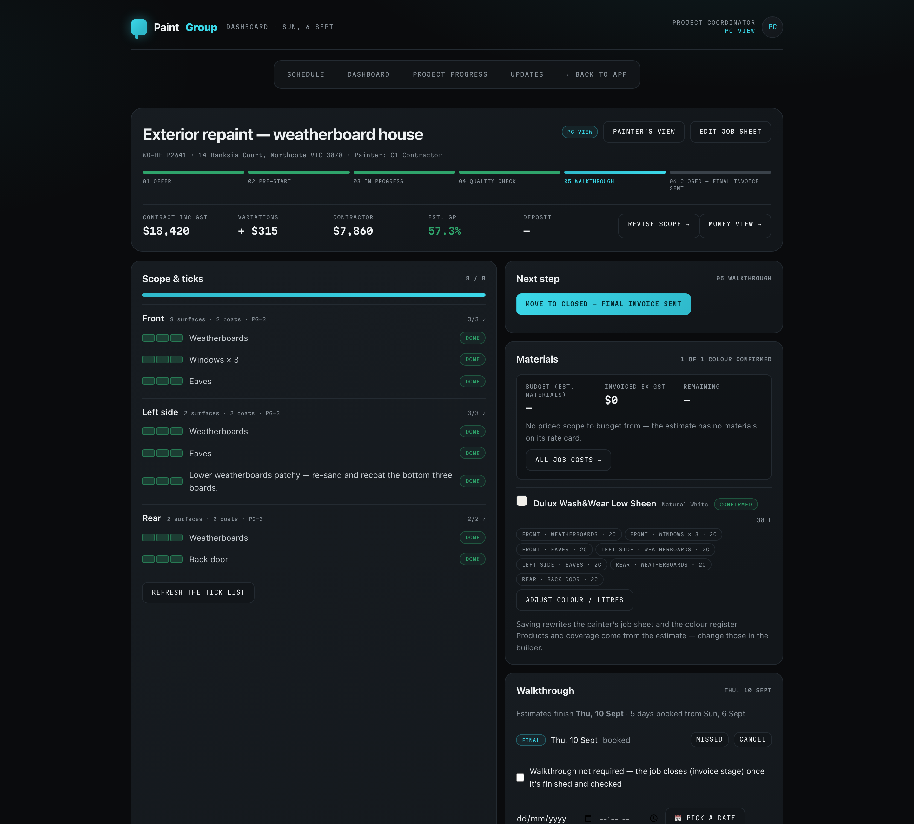
    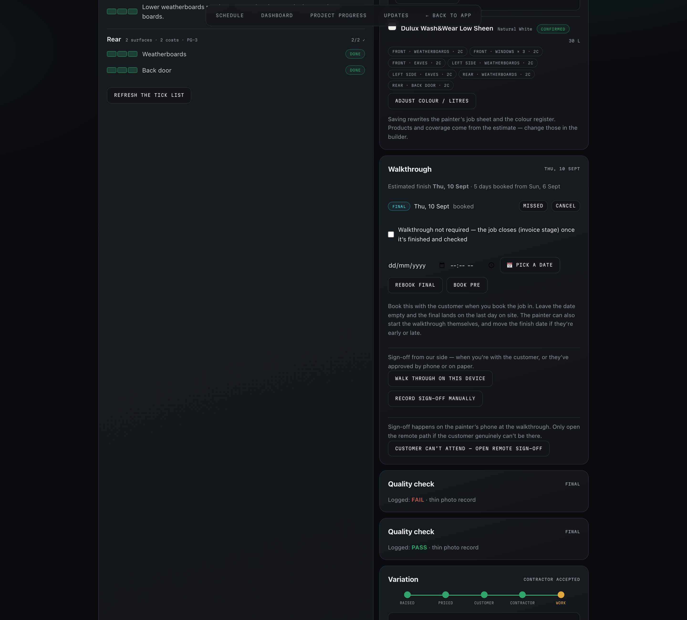
18. The sign-off clock sends the customer reminders at the intervals set under Settings, and the queue shows **Sign-off clock at 48 hours** when it has run that long. Deemed execution is switched off: a job waits at Walkthrough until a person signs, however long the clock runs. An **Extension requested on sign-off** card asks you to approve or decline.
19. A flagged area returns the job to **04 In progress** with the area on the painter's list. A customer who taps **Happy with this** on that area straight after withdraws the flag: the untouched rectify row is removed and the job goes back to **06 Walkthrough** on its own (the event log reads *flag withdrawn*). Once the painter has put it right and ticked it, their **Fixed — send the report** press completes the job straight to **07 Closed**: the sign-off records **Flagged areas put right** (kind *rectified*), the customer is emailed the completion report with a **What you flagged, and what we did** section, and the warranty and invoice drafts fire as they would on a signature. The walkthrough does not run again.

### Closed
20. Signing closes the job: **07 Closed — signed off**, the **Next step** card reads "This job is finished and signed off", and the header gains **Final invoice (draft)**. The final invoice, warranty and completion report are created in that one step. **Something found after sign-off — reopen** takes the job back to Walkthrough for the customer to sign again; it asks for a reason.
    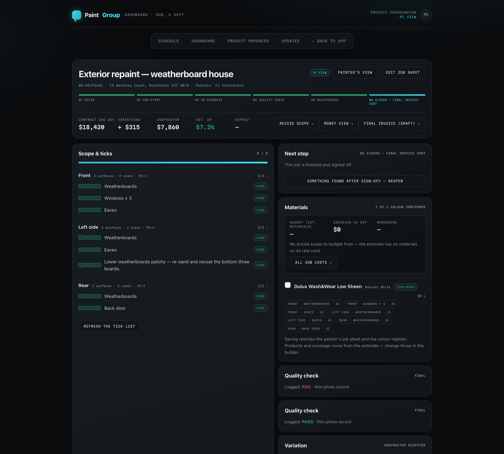
    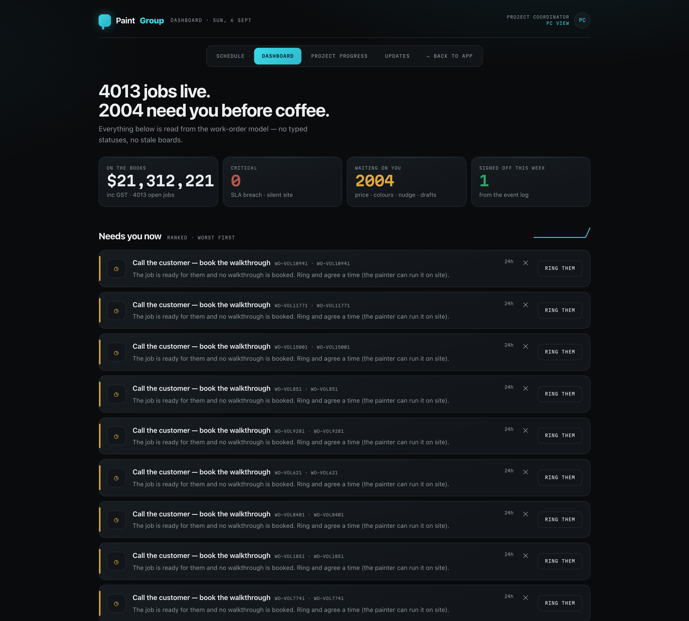

## Reviews, and what the dashboard counts from a job
- **Review card** (walkthrough and completed jobs): **We asked for a review** records that the customer was asked — a person's tick until the review-request automation ships. **Review received** with the stars records that it came back (a person's tick until the Google Business Profile connection). One row per job; asking twice never resets the first ask.
- **Quality check attempts**: every check on a job carries an attempt number — 1 for the first, one more after every fail. "Passed first time" on the dashboard means attempt 1 passed.
- **Finished on time**: the last surface ticked writes the moment the job was done; the booking's end date, moved by the painter's finish date or a reschedule that lengthens the job, is what it is compared with. A longer booking is logged as an extension on the job's activity.

## What the colours and labels mean
- **Amber** — waiting on a decision, usually yours: **WAITING**, **COLOURS TBC**, a queue card with an amber bar, a variation at **RAISED** or **PRICED**.
- **Clay (red)** — overdue or breached: **CRITICAL** tile, **Offer unanswered past SLA**, **Nothing ticked in N days**, an overdue decision.
- **Cyan** — live or informational: the current stage on the rail, **Customer update due**, drafted updates.
- **Emerald (green)** — done: completed stages on the rail, a passed check, **SIGNED OFF THIS WEEK**.
- Lane names: **01 Offer, 02 Booking confirmed, 03 Pre-start, 04 In progress, 05 Quality check, 06 Walkthrough, 07 Closed — signed off**. There is no separate completion-prep lane; the painter's finishing-up list is part of In progress.
- **Orange** (Pre-start lane) — the job starts within three days, or its start date has passed and it has not started.
- **Booking confirmed** and **Pre-start** are the same job stage split by date. A job whose painter has accepted (or been assigned) waits in **Booking confirmed** while its start date is more than seven days away, or has no start date yet. Once the start is within seven days — or has passed without the job starting — the card moves to **Pre-start** by itself; nothing is pressed. The stage rail on the job lights the same lane, and the **Next step** card is headed **02 Booking confirmed** or **03 Pre-start** to match. The pre-start list can be worked in either lane.
- Variation rail: **RAISED → PRICED → CUSTOMER → CONTRACTOR → WORK**.

## If something goes wrong
- **"The pre-start list has to be true before a job can start."** An item is unticked or a question unanswered; colours must be ticked before materials.
- **"Not every paint chip is ordered yet"** / **"Not every gear chip is booked yet"** when you tick a pre-start item: open the Movements board (the chips under the item link straight to it), tick Ordered or place the chip, then tick again — or mark the line Not needed / Painter supplies under the item.
- **"Couldn't read the job's movements"** under the Pre-start card: the chips could not be read — they are not missing. Reload; if it stays, send the line to Tom.
- **"The pre-start list has not been built for this job yet."** The job reached Pre-start without its list. Open the job once: the page builds the list as it loads, and the card appears. If the card still reads **Pre-start · list not built** after a refresh, tell whoever looks after the platform — the job cannot start until the list is there, which is deliberate: an empty list is not a finished one.
- **"1 variation still waiting on a decision."** The painter cannot finish while a variation is unpriced, unsigned or unaccepted. Price it, chase the customer's signature, or approve it for the contractor only.
- **"Every surface has to be ticked off first."** The painter has rows not yet Done. Check **Scope & ticks**, or tick on their behalf from **Painter's view** if you have confirmed the work on site.
- **"N quality checks still open."** Only a *walkthrough not required* job is held by this now (since 21 Oct 2026 the pack goes out with a check open). Log every scheduled check as a pass before that job can close. A logged **FAIL** is not what is holding it: the fail schedules its own re-check, and it is the re-check (or a site check-in you added) that is still unlogged. The card with the standards is the one to work. If the job is at Quality check and the only card reads Logged: FAIL, the painter has not finished again yet — the re-check card appears when they tap **All done — next step**.
- **"No calendar invite — nobody is ticked for QA invite."** Nobody takes quality-check invites yet. In Settings → Staff alerts tick **QA invite** (Email) on Felipe's login; the next change, or the next morning's sweep, sends the current dates.
- **A job sits at Quality check with no card.** No check was due; use **All done — next step** to route it on.
- **The painter says they cannot tick.** The job has no before photo yet (Step 1 on their phone), or the job is not at In progress. **They cannot finish:** the after photos (Step 3) are not in.
- **Every box is ticked and the job will not leave In progress.** Read the **Before the next step** list on the Next-step card: the open ○ line is the reason. Most often it is the after photos — upload them from the card if you have them, or **move on without them** with a reason. If the list is all ✓ and the button still refuses, the words under it name the gate (a variation waiting, an open quality check, a colour-match code).
- **"This job isn't at In progress any more — reload the page."** Someone else (or the painter) moved it while this page was open. Reload to see where it is.
- **The customer never received the variation link.** Check the contact's email and phone on the estimate, then **Text the link** or **Both**.

## Related
- [Offer a job to a painter and manage the booking](../scheduling/staff.md)
- [Approve and pay contractor invoices](../self-invoicing/staff.md)
